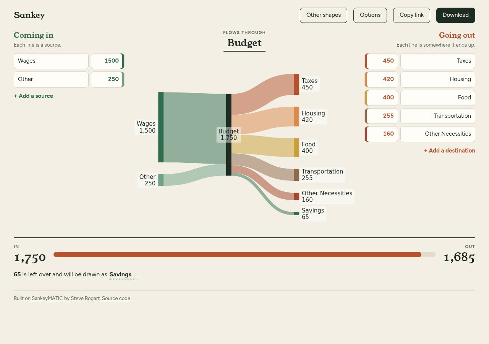

# SankeyMATIC, with the In & Out front end

This is a fork of [nowthis/sankeymatic](https://github.com/nowthis/sankeymatic).
The diagram engine is upstream's. The page around it is new: sources on the
left, destinations on the right, the diagram between them, and a meter that
says whether the two sides balance.



More in [`docs/screenshots/`](docs/screenshots/): the three balance states,
the Options panel, Other shapes, the text view, and the page at phone width.

## What the fork changes

- `build/index.html`, `build/app.css`, `build/app.js`: the In & Out page. It
  writes rows into the engine's text input as ordinary SankeyMATIC syntax, so
  share links, saved files, PNG and SVG export are still the engine's.
- `build/inout-model.js`: the logic behind the rows (no DOM access; tested).
- `build/sankeymatic.js`: a `skm:render` event and `skmShareLink()` so the
  page can read what the engine parsed; a fix for saving text and SVG, which
  threw an error at upstream `a6d8053`; the manual link.
- `build/constants.js`: the `in_out_budget` starter recipe.
- `build/vendor/`, `build/fonts/`: d3, canvg and the two typefaces, served
  from the page's own origin. The page makes no third-party requests, and a
  Content-Security-Policy holds it to that.
- `build/build.css` is removed (replaced by `app.css`).

A diagram that is not "sources, one hub, destinations" opens in a text view
(Other shapes), where anything the engine accepts can be written. Links and
files made with the stock page still open.

## Run and test

```bash
npm start        # serves build/ at http://127.0.0.1:8000
npm test         # unit and static checks (Node 22 or later, no dependencies)
```

`tests/browser/check.js` drives a real browser through the page at desktop
and phone widths (rows, the balance meter, downloads, share links, links made
by the stock page, the Options panel). It needs `playwright-core` and a
Chromium; see the comment at the top of the file. Run it before shipping a
front-end change.

---

The rest of this file is upstream's README.

# SankeyMATIC
## Make Beautiful Flow Diagrams
### A [Sankey diagram](https://en.wikipedia.org/wiki/Sankey_diagram) builder for everyone

* Describe your data using text.
* Customize your diagram's appearance interactively.
* Export a finished product as a PNG image and as SVG code.
* Export/import your work in progress as readable (and diff-able) plain text files.

Hosted and available for use at: **http://sankeymatic.com/build/**

Follow [@SankeyMATIC@vis.social](https://vis.social/@SankeyMATIC) on Mastodon for news and updates.

Produced by **Steve Bogart** ([@nowthis@tilde.zone](https://tilde.zone/@nowthis))

### Packages used:

* [d3.js](https://github.com/d3/d3) version 7.x
* [Canvg](https://github.com/canvg/canvg) 3.0.9

### Background:

SankeyMATIC was inspired by the big energy flow diagram in [d3](http://d3js.org/)'s gallery of examples (visible these days [at ObservableHQ](https://observablehq.com/@d3/sankey)).

Initially built on a [fork of that very d3 Sankey library](https://github.com/nowthis/d3-plugin-captain-sankey) and evolving from there, SankeyMATIC is intended to make it possible for anyone with a web browser to generate complex and beautiful flow diagrams while requiring zero knowledge of coding.
